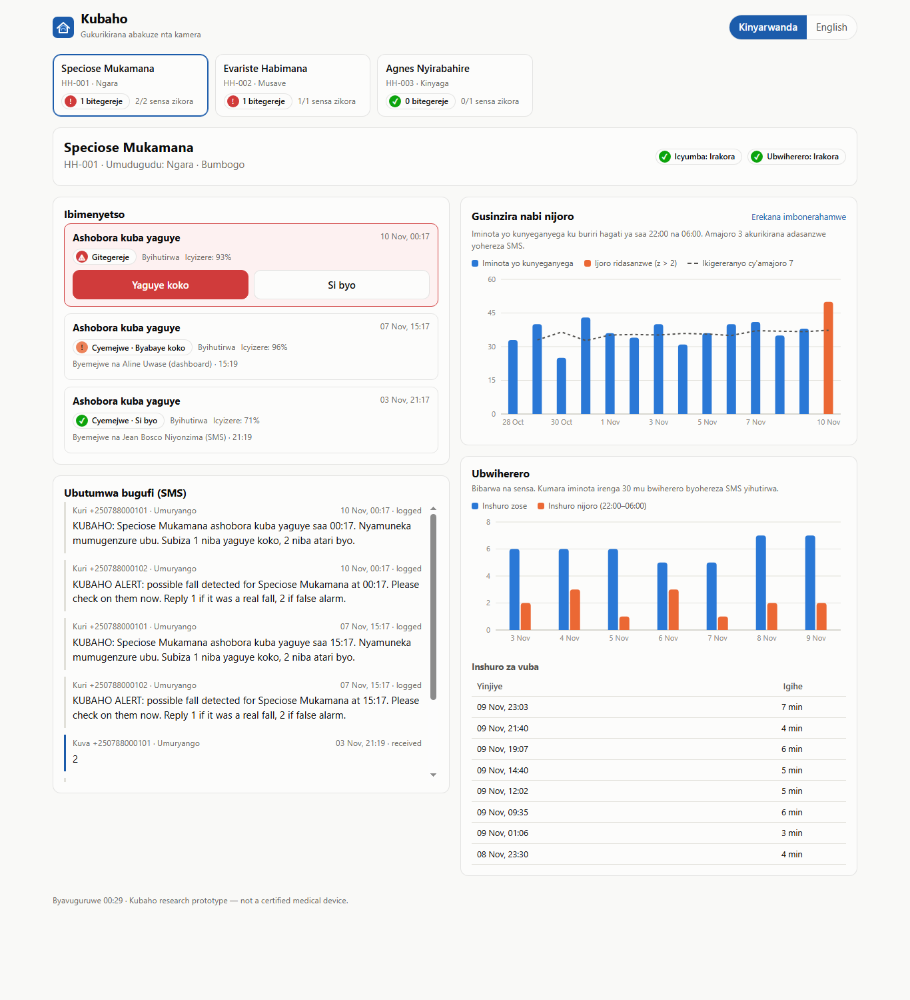
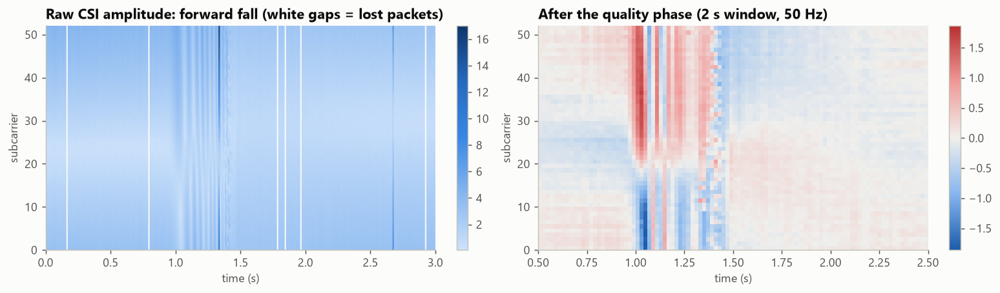
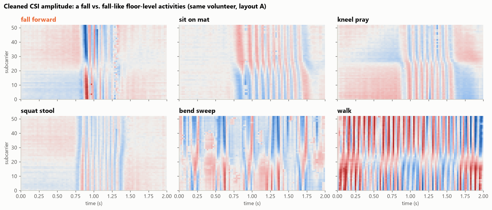
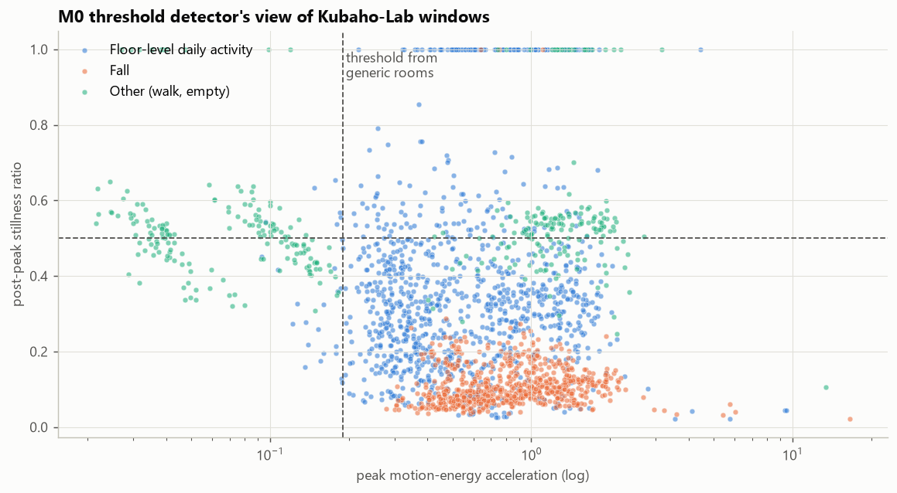
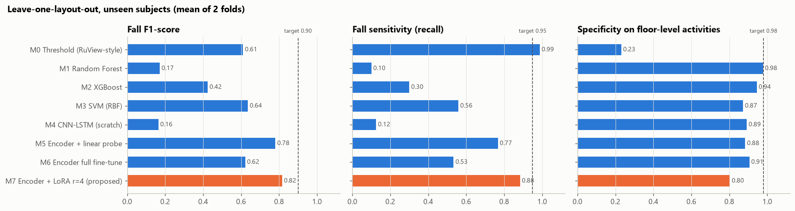
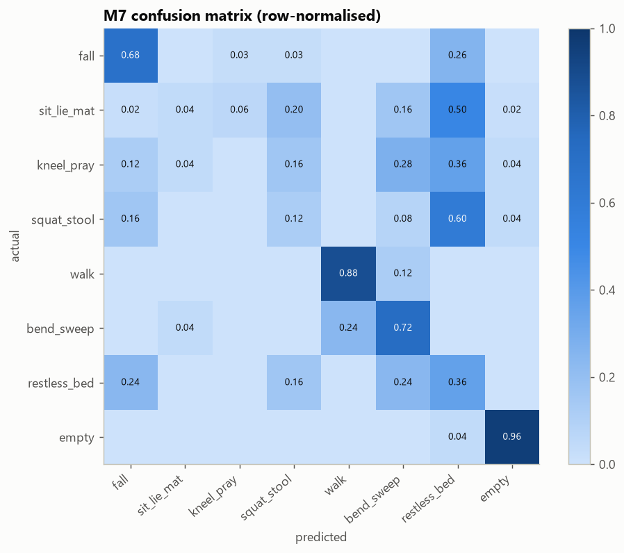
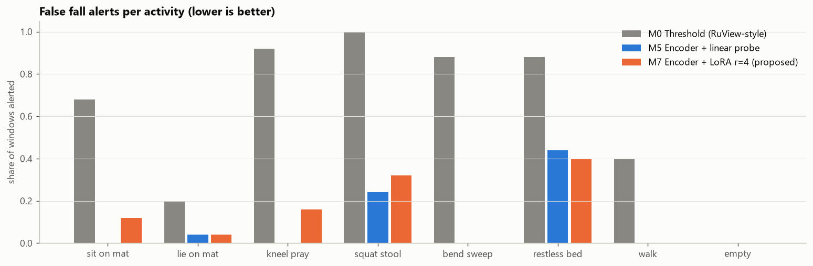

# Kubaho

**A camera-free WiFi-sensing system for elderly fall and wellness monitoring in rural Rwandan homes,
built on π RuView with a LoRA-adapted fall-detection model.**

Queen WIHOGORA · BSc Software Engineering

*Kubaho* is Kinyarwanda for "to live / to exist".

---

## Description

Many older adults in rural Rwanda live alone while their children work in Kigali. After an unwitnessed fall
they can lie on the floor for hours (the "long lie"). Pendants and smartwatches get forgotten, and cameras
feel intrusive.

Kubaho uses a single low-cost **ESP32-S3 node running π RuView**, which reads WiFi **Channel State
Information (CSI)**, the way WiFi signals change as a body moves. It:

- **detects falls** on the node and sends an **SMS (Kinyarwanda/English)** to family members;
- **escalates to the Community Health Worker** if nobody acknowledges within 5 minutes;
- tracks **night-time restlessness** (a z-score against the elder's own 7-night baseline) and
  **bathroom dwell time** (an alert after 30 minutes);
- never records images or audio.

**The ML contribution** is a **LoRA adapter** on RuView's pretrained CSI encoder. It teaches the model that
sitting on a mat, kneeling to pray or squatting on a low stool are *not* falls. Rooms with these floor-level
postures make generic WiFi fall detectors raise false alarms.

### Initial results (preliminary, synthetic data)

> These numbers come from a physics-inspired **synthetic CSI generator** that mirrors the Kubaho-Lab
> protocol (20 volunteers × 12 activities × 2 room layouts, ESP32-S3 noise and packet loss). The encoder is a
> stand-in for RuView's. The pipeline runs end to end.

Protocol: **leave-one-layout-out with unseen subjects**. The model trains on one room (subjects 1–13) and is
tested on the other room with subjects 17–20. Results are the mean of 2 folds; the threshold is calibrated
on validation subjects for ≥ 95% sensitivity.

| Model | Fall F1 | Fall sensitivity | Specificity (floor-level ADLs) | False alerts (mean per test fold) |
|---|---|---|---|---|
| M0 Threshold detector (RuView-style, generic calibration) | 0.61 | 0.99 | 0.23 | 62 |
| M1 Random Forest (features) | 0.17 | 0.10 | 0.98 | 2 |
| M2 XGBoost (features) | 0.42 | 0.30 | 0.94 | 4.5 |
| M3 SVM RBF (features) | 0.64 | 0.56 | 0.87 | 10 |
| M4 CNN-LSTM from scratch | 0.16 | 0.13 | 0.89 | 7 |
| M5 Pretrained encoder + linear probe | 0.78 | 0.77 | 0.88 | 9 |
| M6 Pretrained encoder, full fine-tune | 0.62 | 0.53 | 0.91 | 6.5 |
| **M7 Pretrained encoder + LoRA r=4 (proposed)** | **0.82** | **0.88** | 0.80 | 13 |

- **RQ1 (domain gap):** the generic threshold detector catches almost every fall but also fires on 78% of
  floor-level daily activities (kneeling, squatting on a stool, sitting on a mat).
- **RQ2 (LoRA):** M7 has the best fall F1. It trains **1.58% of the encoder** (4,608 parameters, 18 KB fp32)
  and beats M0 by +20.6 points, significantly (McNemar p < 0.001), and full fine-tuning by +19.5 points
  (p = 0.002). It is only +3.6 points over the linear probe, which is not significant (p = 1.0).
- **Proposal targets:** sensitivity ≥ 95%, specificity ≥ 98% and F1 ≥ 0.90 are not reached on these
  folds. Cross-room multi-class macro-F1 is 0.42. In the simulator's third, never-seen home layout, the
  deployed adapter classified 23 of 32 activity windows correctly with no false alerts and detected 0 of 4
  falls (it called them squatting on a stool).
- **Deployment:** merged LoRA → ONNX → **INT8 (378 KB, vs 1.2 MB FP32)**, 98.8% top-class agreement with
  FP32. It runs in ~1.5 ms per window on a laptop CPU, where FP32 takes 0.9 ms: INT8 helps size, not speed,
  on x86.

All plots and tables are in [`notebooks/kubaho_model.ipynb`](notebooks/kubaho_model.ipynb) and `docs/figures/`.

## Repository

- GitHub: **https://github.com/Q-Reine/kubaho**

```
kubaho/
├── notebooks/kubaho_model.ipynb   # ML notebook: data engineering, visualisation, architecture, metrics
├── notebooks/build_notebook.py    # regenerates the notebook
├── src/kubaho/                    # ML package: synthetic CSI, preprocessing, features, models, training, export
├── api/                           # FastAPI service, MQTT alert worker, SMS, analytics, demo seed
├── simulator/node_sim.py          # simulated ESP32-S3 node (MQTT or HTTP)
├── dashboard/                     # React PWA for caregivers and CHWs
├── models/                        # INT8 ONNX model, LoRA adapter, model card
├── firmware/                      # RuView node configuration, bill of materials, wiring
├── infra/mosquitto/               # MQTT broker configs (dev + production TLS/ACL)
├── docs/                          # diagrams, figures, screenshots, Postman collection
├── tests/                         # API and preprocessing tests
└── docker-compose.yml             # db + mqtt + api + worker + dashboard
```

## How to set up the environment and run the project

### Prerequisites
- Python 3.10+ (developed on 3.12), Node.js 20+, Git
- Docker Desktop (for the full stack)

### 1. Clone and create the Python environment

```bash
git clone https://github.com/Q-Reine/kubaho.git
cd kubaho
python -m venv .venv
# Windows: .venv\Scripts\activate      macOS/Linux: source .venv/bin/activate
pip install torch --index-url https://download.pytorch.org/whl/cpu
pip install -r requirements.txt
```

### 2. Train the model (runs the notebook)

```bash
jupyter nbconvert --to notebook --execute --inplace notebooks/kubaho_model.ipynb
```

This builds the dataset cache in `data/processed/` and pre-trains the encoder. It then benchmarks M0–M7,
logs runs to `mlruns/`, and writes `models/kubaho_lora_int8.onnx` + `models/model_card.json`. To explore it
interactively, open the notebook in Jupyter or VS Code instead.

### 3a. Run everything with Docker

```bash
cp .env.example .env
docker compose up --build
```

| Service | URL |
|---|---|
| API + Swagger UI | http://localhost:8000/docs |
| Dashboard (PWA) | http://localhost:3000 |
| MQTT broker | localhost:1883 |
| PostgreSQL + TimescaleDB | localhost:5432 |

Then load demo data and start a simulated node:

```bash
curl -X POST "http://localhost:8000/demo/seed?reset=true"
python simulator/node_sim.py --scenario demo --mqtt-host localhost       # activities -> /predict -> MQTT events
python simulator/node_sim.py --scenario bathroom --node node-hh001-b --mqtt-host localhost
```

### 3b. Run without Docker (SQLite, no broker)

```bash
uvicorn api.main:app --reload --port 8000        # terminal 1
python -m api.worker                             # terminal 2 (escalation, dwell, restlessness)
python -m api.seed --reset                       # once
python simulator/node_sim.py --scenario demo     # events over HTTP
cd dashboard && npm install && npm run dev       # http://localhost:5173
```

### Tests

```bash
pytest
```

### SMS

SMS are sent through [Africa's Talking](https://africastalking.com) using `AT_USERNAME`, `AT_API_KEY` and
`AT_SENDER_ID` from `.env`. Every message is also stored in the `sms_log` table and shown in the dashboard.
The AT incoming-SMS callback points at `POST /sms/incoming`, so caregivers reply `1` (real fall) or `2`
(false alarm).

## API

Interactive documentation at **`/docs`** (Swagger UI). A Postman collection is in
[`docs/postman/kubaho.postman_collection.json`](docs/postman/kubaho.postman_collection.json).

| Method | Endpoint | Purpose |
|---|---|---|
| GET | `/health` | service, database, MQTT, SMS mode, model status |
| GET | `/model` | model card (classes, threshold, metrics) |
| POST | `/predict` | classify a 2 s CSI window (200 × 52 amplitudes) |
| POST | `/events` | ingest a node event (same handler as MQTT) |
| GET/POST | `/households`, `/households/{id}` | households, people, nodes |
| GET | `/households/{id}/alerts` | alert history |
| POST | `/alerts/{id}/ack` | acknowledge: `confirmed` / `false_alarm` |
| GET | `/households/{id}/restlessness` | nightly restlessness index + z-score |
| GET | `/households/{id}/bathroom` | bathroom visits and dwell time |
| GET | `/households/{id}/sms` | SMS log |
| POST | `/sms/incoming` | Africa's Talking reply callback |
| POST | `/demo/seed` | load three fictional demo households |
| GET | `/demo/sample-window` | synthetic CSI window to try `/predict` |

## Designs

### Caregiver / CHW dashboard



### Notebook figures

| | |
|---|---|
|  |  |
|  |  |
|  |  |

## Deployment plan

| Stage | What |
|---|---|
| 1. Local MVP | `docker compose up`: API, worker, broker, database, dashboard; simulated nodes; SMS log |
| 2. Lab data & real adapter | Record Kubaho-Lab (20 volunteers, 2 layouts) after RNEC approval; swap the RuView encoder and real data into the notebook; retrain and re-benchmark |
| 3. Edge model | Convert the merged INT8 model for the ESP32-S3 (ESP-DL / TFLite-Micro) and confirm < 200 ms on-device latency; flash RuView with Kubaho config |
| 4. Cloud | One VPS (2 vCPU / 4 GB, Ubuntu 24.04), same Docker Compose stack behind **Nginx + Let's Encrypt TLS**; Mosquitto on 8883 with per-node credentials and ACLs (`infra/mosquitto/mosquitto.prod.conf`); `.env` secrets; Africa's Talking live account with sender ID; nightly `pg_dump` backups |
| 5. Pilot | 8 households in Bumbogo, one node each (+ bathroom node where indoors); CHWs and families onboarded with the PWA; replies of 1/2 to alert SMS give ground truth |
| 6. Evaluate & iterate | False alarms per household per week, fall-to-SMS time, uptime and the caregiver Likert survey; retrain the adapter on field windows and push it over the air |

**Model updates (MLOps).** Each adapter is versioned (`models/model_card.json` + the `adapters` table) with
its metrics and threshold. A new adapter is promoted only if it beats the current one on the held-out
layouts. Nodes download it over the air (RuView OTA), and the old adapter is kept for rollback.

**Monitoring.** The node last-will marks nodes offline on the dashboard; the worker logs every alert,
escalation and SMS status; `/health` is polled by an uptime checker; restlessness and false-alarm rates are
reviewed weekly.

**Security & privacy.** No images or audio. Raw CSI never leaves the node. TLS on MQTT and HTTPS. Households
are pseudonymised. Access is limited to the household's caregivers and CHW. Compliant with Rwanda's Law No. 058/2021 on personal data.

Kubaho is a research prototype and an alerting aid, **not a certified medical device**.
