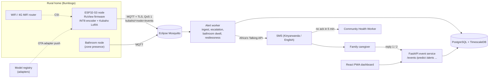
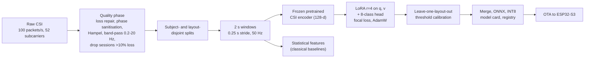
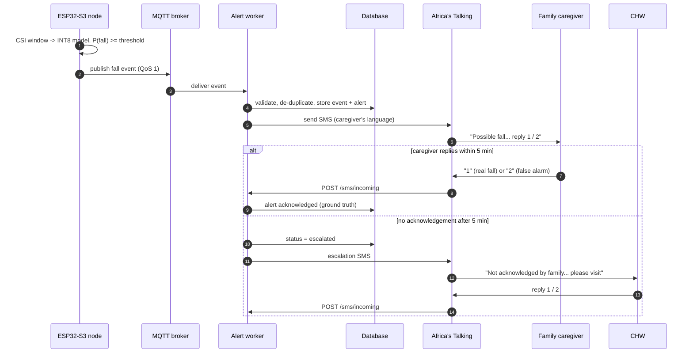
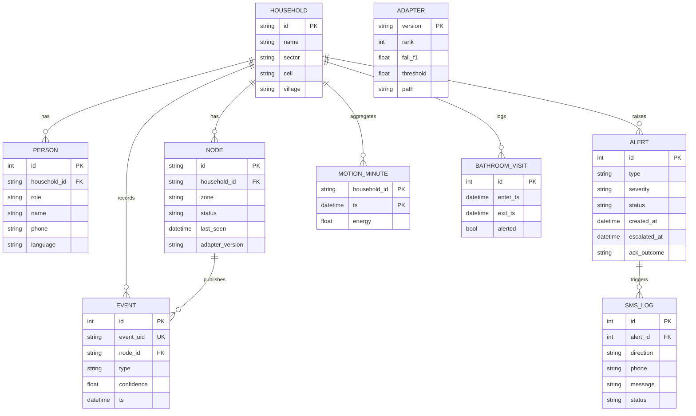
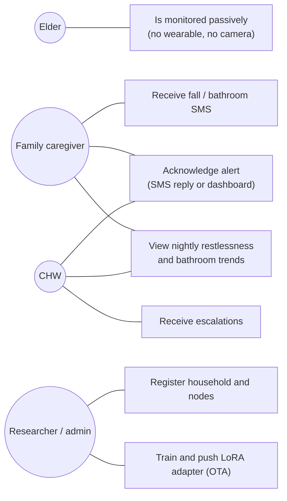

# Kubaho design diagrams

All diagrams are Mermaid, so GitHub renders them directly.

## System architecture (proposal Figure 3)

## ML training pipeline (proposal Figure 4)

## Sequence: fall detection, alerting and escalation (proposal Figure 8)

## Entity relationship diagram (proposal Figure 7)

## Use cases (proposal Figure 5)

