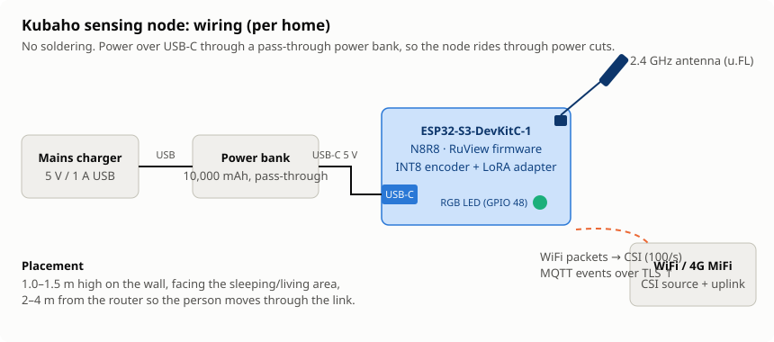

# Sensing node (ESP32-S3 + π RuView)

Kubaho does not fork the RuView firmware. Each node runs upstream RuView (MIT) with three settings changed:

| Setting | Value | Why |
|---|---|---|
| CSI rate | ~100 packets/s, HT20 (52 subcarriers) | matches the training data |
| Fall model | `kubaho_lora_int8` (merged encoder + LoRA adapter) | replaces the generic detector |
| MQTT | broker `mqtt.<server>:8883`, TLS, per-node credentials, QoS 1 | see `infra/mosquitto/mosquitto.prod.conf` |

## Bill of materials (per home)

| Item | Qty | Notes |
|---|---|---|
| ESP32-S3-DevKitC-1 (N8R8, 8 MB flash / 8 MB PSRAM) | 1 (+1 for an indoor bathroom) | PSRAM holds the model |
| 2.4 GHz external antenna (u.FL / IPEX) | 1 | improves CSI SNR |
| USB-C 5 V / 1 A phone charger + 1 m cable | 1 | mains power |
| 5 V USB power bank (10,000 mAh) | 1 | rides through power cuts (about 2 days) |
| 4G MiFi router | 1 | only if the home has no WiFi; the node senses its traffic |
| Wall mount / 3D-printed enclosure | 1 | 1.0–1.5 m high, facing the sleeping/living area |

## Wiring



No soldering is needed. The board is powered over USB-C, through the power bank (pass-through charging) so
it keeps running during power cuts. The on-board RGB LED (GPIO 48) shows status: green = online,
blue = sensing, red = no broker.

## Events published

Topic `kubaho/<node_id>/events`, JSON, QoS 1:

```json
{"event_id": "uuid", "node_id": "node-hh001-a", "type": "fall", "ts": "2026-11-09T21:14:03Z", "confidence": 0.93}
{"event_id": "uuid", "node_id": "node-hh001-a", "type": "motion_summary", "ts": "...", "energy": 0.41}
{"event_id": "uuid", "node_id": "node-hh001-b", "type": "bathroom_enter", "ts": "..."}
```

Availability topic `kubaho/<node_id>/status`: `online`, with the last-will `offline`.

`simulator/node_sim.py` publishes exactly these messages, so the backend can be tested without hardware.
